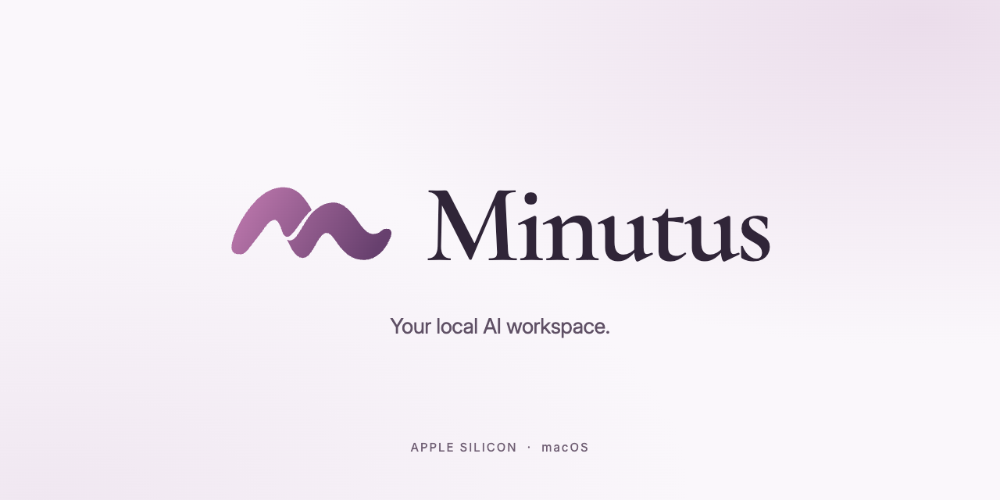
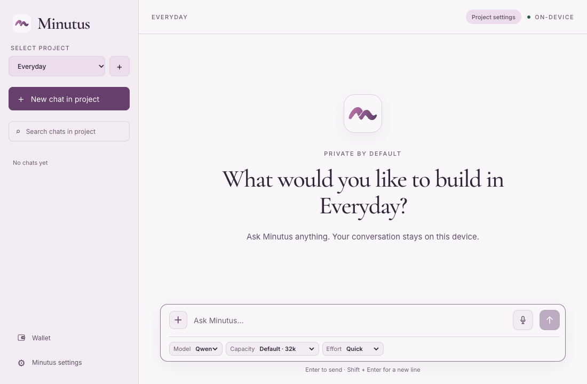

# Minutus

Minutus is a local AI desktop application for Apple Silicon macOS. It combines
local chat and image understanding, optional dictation, permissioned workspace
tools, web retrieval, and an optional EVM wallet with trusted native approvals.

Chat inference and speech recognition run on your Mac. Network features have
separate purposes and boundaries; see [privacy](docs/privacy.md). Model weights
can be downloaded in-app or imported from local files. They are not included
in this repository or app bundle.

## A quick look



*UI demonstration with a scripted sample response; timing is illustrative.
[View the still image](docs/media/minutus-chat.png).*

## Run from source (release build)

> **Early source beta — `0.1.0-beta.1`.** Features may fail,
> compatibility is still being validated, and breaking changes are expected.
> Not recommended for production use.

The initial beta is distributed as source on GitHub. A signed, notarised Apple
Silicon DMG will follow developer validation. The release
configuration below produces a local build but does not indicate a stable release.

Requires Apple Silicon macOS 13.3+, Xcode command-line tools, CMake 3.24+,
Python 3.12+, Node.js 22.23.4, pnpm 10.2.0, and Rust via rustup. The Rust toolchain and
package dependencies are pinned in this repository.

From the repository root, build and open the optimised application:

```sh
# First-time toolchain setup with nvm:
nvm install
nvm use
npm install --global pnpm@10.2.0

# Install locked dependencies, bootstrap, check and build:
./scripts/setup-release.sh
open target/aarch64-apple-darwin/release/bundle/macos/Minutus.app
```

On subsequent builds, run the script and then `open`. The script selects the
pinned Node version with nvm when available, checks prerequisites and stops on
the first failure. It does not launch the app or install system prerequisites.

Bootstrap downloads hash-verified public runtime sources and native runtime
archives, then builds the tokeniser, speech helper and computation service.
It does not download model weights. Choose Download or Import local files in
the app during model setup.

The local app is signed ad hoc and works without an Apple developer account or
certificate, including its wallet. Official distribution signing and notarisation
are separate. See [build instructions](docs/build.md) for troubleshooting and
[privacy](docs/privacy.md) for local storage and logging.

## Capabilities

| Use case | What Minutus currently supports |
| --- | --- |
| Chat and reasoning | Local text conversations, streamed replies, project chat history, and Quick/Balanced/Deep effort controls. |
| Image understanding | Questions about static PNG, JPEG and WebP images, including images in a granted workspace. Vision requires the matching model projector; at most four images per model request. |
| Workspace assistance | Find, search and read granted files; create folders and edit text, code, CSV and TSV with write permission. File edits have diffs and explicit undo. Credential and execution-control paths are protected. |
| Computation and data tasks | Bounded JavaScript computation in an isolated native service, including calculations over explicitly bound project inputs. It has no general shell, Python environment or ambient filesystem/network access. |
| Web research (search requires configuration) | Brave Search with a configured API key, and bounded public HTTPS retrieval. Native approval shows the search query or full retrieval URL. This is retrieval, not interactive browser automation. |
| Dictation | Local microphone transcription into an editable message draft using a separately installed Whisper model. You review and send the message yourself. |
| Optional EVM wallet | Native wallet creation/recovery and balances. The Wallet screen and chat support reviewed ETH/native USDC transfers on Base and Ethereum, including their Sepolia testnets. Chat requires an explicit network, hexadecimal recipient and exact amount. Arbitrary contract calls remain unavailable. One app password protects independent accounts. Native approval is required for signing and payments; the model cannot approve spending. |
| Paid x402 resources | Public HTTPS services using x402 v2 exact USDC payments on Base mainnet, with separate native outbound-request and payment review. Supports bodyless GET resources and bounded Bazaar JSON POST purchases. See [supported scope](docs/x402.md) and [wallet versus chat capabilities](docs/usage.md#evm-capabilities-by-entry-point). |

Web search/retrieval, model downloads and wallet RPC contact external services.
Local chat and dictation need no cloud inference account. See
[privacy](docs/privacy.md) and [security](docs/security.md) for the boundaries.

## First run

1. Choose a model on the setup screen and download it, or choose **Import local
   files** if you have the exact supported weights. Every required module must
   be verified before setup completes; optional modules can be added later.
2. Create a project, then start a chat. Folder access is optional.
3. To work with files, add a specific project folder in project settings. Access
   starts read-only; enable **Read and write** in **Project settings > Folder
   access** before requesting file creation or edits.
4. For web search, add your Brave Search API key in **Minutus settings**. Dictation
   needs its separate speech model; the wallet is optional too.

See [using Minutus](docs/usage.md) for model import, folder permissions, wallet
recovery and common problems.

## Model compatibility

The bundled catalogue supports these profiles. Download sizes include all declared
companions; memory recommendations are starting points, not measured requirements
for every task or context size. Weights are installed separately from the app.

| Model/profile | Status | Supported role | Download / recommended unified memory |
| --- | --- | --- | --- |
| **Qwen3.8 27B · GGUF (Q4_K_M + MTP)** | Recommended chat profile | Text, reasoning, image understanding and native tool calls for workspace, computation and web workflows | About 16.5 GiB complete bundle; 30 GiB memory recommended |
| **Muse Glimmer 30B · GGUF (Q4_K_M)** | Integrated alternative | Text, reasoning, image understanding with its projector, and structured tool calls for the same app workflows | About 18.4 GiB complete bundle; 24 GiB memory recommended |
| **Whisper large-v3-turbo Q5_0** | Separate optional dictation model | Speech-to-text input for either chat profile; not selectable as a chat model | About 547 MiB; installed independently |

Both chat profiles default to a 32,768-token context. Catalogue maxima are
131,072 for Glimmer and 262,144 for Qwen; larger windows need additional memory
and are not qualification claims. Configured output ceilings are 4,096 tokens
for Glimmer and 8,192 for Qwen, shared by reasoning, text and tool calls; execution
profiles can use less.

Already have the weights? **Import from local files** verifies the exact catalogue
revision and quantisation and uses the files in place. It never copies, moves or
deletes external weights. SHA-256 is checked on import and when locating files
again. Later checks use file access, size and modification time; weights are not
rehashed on startup or before each response. If files move, expand the import
controls in Settings and use **Locate local files**.
See [model setup and troubleshooting](docs/usage.md#models).

This is not a general loader for arbitrary GGUFs, Safetensors files or Ollama
tags. Other chat models and cloud inference providers are not integrated. The experimental
MLX profile is hidden and disabled in release builds. Image/video/audio
generation, spoken responses and live voice/video conversations are not current
app capabilities; image understanding and dictation are separate input features.

## Accelerated Qwen

Minutus bundles [Accelerated Qwen](https://github.com/omarperacha/accelerated-qwen-3.8),
a Metal-optimised local inference backend for the supported Qwen 27B configuration
on Apple Silicon. It optimises token generation and internal model-state handling
while using the same model weights and image projector. It runs on your Mac,
and Minutus manages it alongside the standard runtime, so no separate Ollama
installation is needed. Automatic acceleration is currently enabled for the measured 10-core M1 Pro with
32 GiB unified memory. The measured tuning uses the pinned model/runtime, a 32k
context and one managed slot. Other Macs use the standard backend. Larger context
windows use manifest settings rather than the measured tuning. The model listing
alone does not promise acceleration or the same performance on every Mac.

## Qwen agent behaviour

Minutus follows Qwen's structured assistant/tool conversation pattern, with
separate thinking, visible content and tool-call channels. Quick disables thinking;
Balanced and Deep use medium and high effort. Minutus retains its own context
limits, tool controller, permissions and payment approvals. It does not claim
identical prompts or benchmark parity with Qwen-Agent. See the
[technical comparison](docs/qwen-agent-alignment.md).

## Development

Packaged staging uses **Minutus Staging.app** and a separate data profile from
release builds. For frontend hot reload and Rust debug builds, use the development runner after
installing dependencies and bootstrapping the native inputs above.

**Debug builds retain sensitive local traces.** `tauri:dev` and the default
`tauri:stage` build record raw tool arguments/results, which can contain workspace
text, paths and URLs. The ordinary logging preference does not disable these
traces. Use synthetic data and keep traces out of public reports. Release builds
omit this tracing; see [logging details](docs/privacy.md#models-and-diagnostics).

```sh
pnpm tauri:dev
```

Public HTTPS x402 purchases are available in release builds. The separate
localhost/Base Sepolia qualification transport remains debug-only and requires
an explicitly configured scope. See [x402 support](docs/x402.md).

## Contact

Minutus is sponsored by [FlowZed](https://flowzed.com/?ref=github).
For questions or support, email [hello@minutus.ai](mailto:hello@minutus.ai).
For vulnerability reports, follow [SECURITY.md](SECURITY.md).

## Licence

Original Minutus code is Apache-2.0. Fonts, bundled runtimes and model weights
have their own licences; see [third-party notices](THIRD_PARTY_NOTICES.md).
The accelerated Qwen dependency is pinned from
[accelerated-qwen-3.8](https://github.com/omarperacha/accelerated-qwen-3.8).
